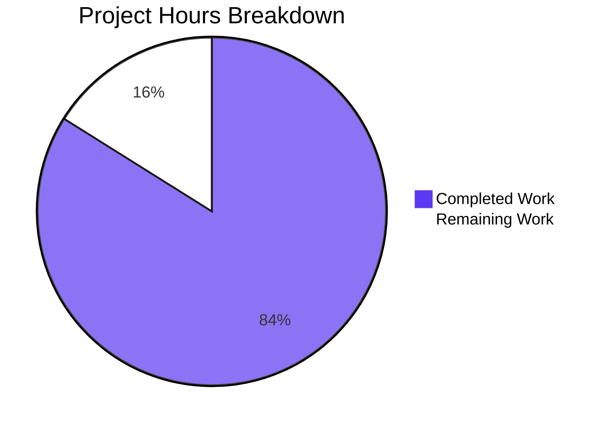

# 1. Executive Summary

## 1.1 Project Overview

A zero-dependency Node.js service that answers `GET /hello` with `200` and a fixed body, and every other method or path with `404`. It is a teaching reference: the smallest complete demonstration of endpoint creation and request handling with no framework, middleware or routing library, built on the standard library alone. The scope is three files at the repository root: `server.js`, `package.json` and `README.md`, with no build step, dependency or data store.

## 1.2 Completion Status

Completion is 47.0 of 56.0 hours = **84%** (47.0 / 56.0 = 83.93%). The 9 remaining hours are path-to-production work only.



Completed Work = Dark Blue (#5B39F3); Remaining Work = White (#FFFFFF).

| Metric | Hours |
|--------|-------|
| Total Hours | 56.0 |
| Completed Hours (AI + Manual) | 47.0 |
| Remaining Hours | 9.0 |

## 1.3 Key Accomplishments

- The closed wire contract verified end to end: `GET /hello` → `200`, `text/plain`, `Content-Length 11`, body `Hello world`; every other method or path → `404`, `Content-Length 9`, body `Not Found`, never `405`.
- Matching rules exact — `/hello?x=1` → 200 while `/Hello` and `/hello/` → 404 — with one ISO-8601 log line per handled request, written before routing.
- `PORT` complete: default 3000 for unset or blank input, range 1024–65535, and one actionable stderr sentence with exit 1 for every rejected value.
- Clean lifecycle: one ready line, `SIGINT` → `Server shutting down` / `Server stopped` with exit 0, and tracked sockets destroyed so the stop never waits out the keep-alive default.
- Bind failures actionable for `EADDRINUSE`, `EACCES` and any other listen error — one stderr sentence, exit 1, a followable remedy, no stack trace or configuration dump.
- Performance inside budget and an empty dependency tree: p50 0.16 ms / p95 0.22 ms on `/hello`, fifty simultaneous requests all served, memory plateauing across 1,000 requests.

## 1.4 Critical Unresolved Issues

**4 of 28 mapped requirements carry a caveat or an unexercised criterion; none blocks release.**

| Issue | Impact | Owner | ETA |
|-------|--------|-------|-----|
| The declared `>=18.0.0` floor has not been exercised on an 18.x runtime; compliance rests on a facility audit | A post-floor API or behavioural difference would surface only in an 18.x deployment | Developer | 3 h |
| The `EACCES` and generic listen-error branches have no organic bind trigger on this host; they are covered by a namespace bind denial and by fault injection | A platform-specific bind denial could present a path exercised only synthetically | Developer | 2 h |
| The two fatal startup paths call `process.exit(1)` right after the stderr write, so a piped write could in principle be truncated | Affects only supervisors reading a piped stderr; the exit status is deterministic | Developer | 1 h |
| The shipped `EADDRINUSE` remedy names `PORT=65534` at the top of the range, where the specification writes `PORT=<port+1>` | One operator message in one reachable case differs from the documented literal | Developer | 1 h |

## 1.5 Access Issues

No access issues identified.

## 1.6 Recommended Next Steps

1. **[High]** Run the acceptance procedure on a Node 18.x runtime to prove the declared floor (3 h).
2. **[High]** Produce a genuine denied bind on the deployment host and confirm both listen-error sentences, empty stdout and exit 1 (2 h).
3. **[Medium]** Replace the forced exit on the fatal paths with a set exit status, and decide the runtime-floor policy (2 h).
4. **[Low]** Align the specification's `EADDRINUSE` literal with the bounded remedy, or record the deliberate difference (1 h).

# 2. Project Hours Breakdown

## 2.1 Completed Work Detail

| Component | Hours | Description |
|-----------|-------|-------------|
| Request pipeline: routing, response framing and per-request logging | 11.0 | The exact `(method, pathname)` `Map` lookup, the two handlers, `sendPlainText` with explicit `Content-Type`/`Content-Length`, query-string stripping, and the ISO-8601 log line emitted before routing (`server.js:28-31,92-94,106-110,119-121,134-136,150-156,165-167,187-194`) |
| PORT configuration and validation | 5.0 | `readPort` with the blank-or-undefined default first, the `/^\d+$/` test, the 1024–65535 range, and the fixed actionable failure sentence with exit 1 (`server.js:19-25,47-80,197`) |
| Process lifecycle and shutdown | 7.0 | The ready line from the listen callback, socket tracking with deletion on close, the `SIGINT` handler that sets exit status 0, closes the listener and destroys tracked sockets, and its run-once guard (`server.js:178,200-241,244-274`) |
| Bind-failure reporting | 4.0 | The documented `'error'` listener with its three branches — `EADDRINUSE` with the in-range remedy, `EACCES`, and any other listen error — each one fixed sentence on stderr and exit 1 (`server.js:209-236`) |
| `package.json` manifest | 1.0 | The seven fixed metadata fields, the `>=18.0.0` engine floor, the `node server.js` start script, and the zero-dependency posture |
| README runbook | 5.0 | Purpose, prerequisites, installation, both run commands, the documented `curl` test, expected output, shutdown instructions and `PORT` configuration, plus the failure and behaviour references (`README.md:1-230`) |
| Built-in-only facility compliance and negative boundaries | 3.0 | The single `node:http` import, avoidance of every post-floor facility, and the absence of framework, dynamic evaluation, file access, outbound network, persistence and input processing beyond path matching |
| Latency, concurrency and resource behaviour | 4.0 | The shape that delivers the budget: constant bodies, no I/O on the request path, explicit framing, and the socket set that releases on close |
| Comment and documentation accuracy | 3.0 | The module header, the per-function contracts, the decision comments on the default rule and the bind-failure contract, and the alignment of every documented literal with the code |
| Acceptance verification over the whole tree | 4.0 | The documented acceptance sweep plus the configuration matrix, lifecycle, adversarial-request, latency, concurrency, memory and browser passes |
| **Total** | **47.0** | |

## 2.2 Remaining Work Detail

| Category | Hours | Priority |
|----------|-------|----------|
| Prove the declared `>=18.0.0` runtime floor on a real 18.x line (syntax check, ready line, the full curl contract, the `PORT` matrix, `EADDRINUSE` and clean shutdown) | 3.0 | High |
| Confirm the `EACCES` and generic listen-error branches on the deployment host with a genuine denied bind | 2.0 | High |
| Replace the forced exit on the two fatal startup paths with a set exit status so a piped stderr write cannot truncate the fixed sentence, then re-verify the `PORT` matrix and the occupied-port case | 1.0 | Medium |
| Decide and record the runtime-floor policy, since the declared floor admits a Node line that has reached end of life | 1.0 | Medium |
| Deployment smoke test and operator handover on the target host (start with the intended `PORT`, confirm the documented `curl`, the request log and the shutdown transcript) | 1.0 | Medium |
| Align the specification's `EADDRINUSE` failure-table literal with the bounded remedy the code emits, or record the deliberate difference | 1.0 | Low |
| **Total** | **9.0** | |

## 2.3 Hours Estimation Basis

Total project hours are the sum of the completed and remaining figures above: 47.0 + 9.0 = 56.0 hours, and the completion figure is completed ÷ total = 47.0 / 56.0 = 83.93%, reported as 84%.

Completed hours were derived per delivered component from its size and complexity (`server.js` is 274 lines of self-contained service logic, `README.md` 230 lines, `package.json` 19 lines), weighted by the behaviour it implements: a stateless constant-body request pipeline, a single validation rule with four failure sentences, a signal-driven lifecycle with socket teardown, and a closed documentation set. Verification is folded into each component rather than listed separately, because the delivered artefact and the evidence that it behaves are the same work at this scale.

Remaining hours are path-to-production work only, each traced to a specific requirement or an operational need: floor verification against the declared engine range, live confirmation of the two bind-denial branches, hardening the fatal-failure exit path, the runtime-floor policy decision, the deployment smoke and handover, and the specification literal. No requirement is unimplemented, so no hours are carried for missing functionality, and none of the estimates cover work the specification excludes — no test framework, linter, formatter, container, pipeline, monitoring stack, TLS termination or additional endpoint.

# 3. Test Results

The project ships no test framework, test file, coverage instrument or security scanner — that is its deliberate design — so there is no suite to run and no coverage percentage to quote. What follows is the project's own documented acceptance procedure, executed against the running service on this host (Node.js v22.23.3, npm 11.21.0), plus in-browser passes over the same instance. Every figure below was observed first-hand.

| Area / Category | Framework | Tests | Passed | Failed | Coverage | What This Proves |
|---|---|---|---|---|---|---|
| Wire contract and routing — `GET /hello`, query string, case, trailing slash, five non-GET methods, `HEAD`, unmatched requests carrying bodies up to 1 MiB | curl and Node clients (no committed framework) | 51 checks | 51 | 0 | Both routes over 8 method/path classes, both framing values (11 and 9) | The status, header and body contract is exact on the 200 path and the method-agnostic 404 path, `405` is never returned, and an unmatched body-bearing request is still answered with no connection reset |
| Configuration surface — ready line, default resolution, rejected values, range bounds, override | bash + curl | 66 checks | 66 | 0 | The whole `PORT` input space: unset, empty, whitespace, 10 rejected values, both bounds | `PORT` is read once from the environment, blank input resolves to 3000, and every other rejected value exits 1 with the byte-exact sentence and no stdout |
| Lifecycle and shutdown — `SIGINT` transcript, exit status, port release, idempotence under load | bash + Node | 10 checks | 10 | 0 | Single signal and a 50-signal flood with 200 connections held | The stop sequence is ordered and run-once, the exit status is 0, and the port is released without waiting out the keep-alive default |
| Bind-failure reporting — live occupied port, the bounded remedy, `EACCES`, generic listen error | bash + Node + fault injection | 14 checks | 14 | 0 | All three branches, including the top of the accepted range | Each failure produces one fixed, detail-free stderr sentence and exit 1, and the remedy the message prints is a command the server accepts |
| Manifest and dependency posture — `npm ls`, `npm pkg get`, key inventory, `npm start` | npm CLI | 10 checks | 10 | 0 | All three files | Seven metadata fields hold their exact values, the dependency tree is empty, and `npm start` boots the same service |
| Latency and concurrency — 500 keep-alive samples per path, a 50-request simultaneous wave, 20 sequential and 10 concurrent in-browser fetches | Node built-in timing harness + headless browser | 1,080 requests | 1,080 | 0 | p50/p95/max on both routes, browser and server side | `/hello` answers far inside the 10 ms budget (p50 0.16 ms, p95 0.22 ms, no sample over 10 ms) and simultaneous requests are all served without blocking |
| Memory and resource behaviour — resident memory across 1,000 requests and socket release at shutdown | Node harness reading the server's own status | 1,000 requests | 1,000 | 0 | 0 / 500 / 1,000 request marks | Memory plateaus rather than accumulating (58,196 → 59,808 → 58,564 kB), confirming the socket set releases entries on close |
| Adversarial request lines — SQL-ish, traversal, markup, NUL, sensitive paths, JNDI strings, double encoding, an 8 KB target | curl and Node clients | 11 requests | 11 | 0 | 11 hostile classes | Hostile targets reach the catch-all and receive the fixed 404 with no 5xx, no reflection, no control bytes in the log and no leaked detail |

**Not Covered**

- There is **no committed test framework, test file, coverage instrument or security scanner** — the specification excludes all of them — so the figures above come from the documented acceptance procedure run by hand, and no coverage percentage exists. Anything not listed above is untested by tooling.
- The **`EACCES` sentence and the generic listen-error sentence were not produced by an organic bind** on this host: every port is unprivileged and the process runs as root, so a genuine denial is unreachable. The `EACCES` branch was driven inside a private user, network and PID namespace with the unprivileged-port threshold raised and the bind capability dropped, and the generic branch by injecting a listen error into the real source.
- **No execution on a Node 18.x runtime.** Floor compliance rests on a facility audit of the source against the declared `>=18.0.0` range, not on a run at the floor.
- **No long-duration soak, no TLS, container, pipeline or multi-host deployment, and no load beyond the bounded bursts** described above; nothing in the specification requires them, but none has been exercised.
- **No client other than curl, Node's own HTTP client and a Chromium browser** has been pointed at the service; HTTP/2, proxies and non-browser clients are untested.
- Before release, a human should run the acceptance procedure on an 18.x line and produce a genuine bind denial on the deployment host (both listed in Section 2.2).

# 4. Runtime Validation & UI Verification

The product has no visual interface: every response is `text/plain` and the service writes plain text to the console, so runtime validation means driving the listener with real clients — curl, Node's own HTTP client and a Chromium browser — and reading the process's own output and exit statuses.

- ✅ **Startup** — `node server.js` and `npm start` each print exactly `Server listening on port <port>` as the first stdout line, with zero bytes on stderr and the listening socket owned by the started process; the default port path prints `Server listening on port 3000`.
- ✅ **`GET /hello`** — `200`, `Content-Type: text/plain`, `Content-Length: 11`, body byte-exact `Hello world` with no trailing newline, observed over curl, over a keep-alive Node client and in two in-browser passes.
- ✅ **Catch-all 404** — `/invalid`, `/Hello`, `/hello/`, `/`, `//hello`, `/nested/deep` and `POST`/`PUT`/`PATCH`/`DELETE`/`OPTIONS` on `/hello` all return `404`, `text/plain`, `Content-Length: 9`, body `Not Found`; `405` never appears, no `Allow` header is sent, and a body-bearing unmatched request returns cleanly with no connection reset.
- ✅ **Routing edges** — `/hello?x=1` → `200` while `/Hello` and `/hello/` → `404`, and `HEAD /hello` → `404` with `Content-Length: 9` and zero body bytes on the wire.
- ✅ **Request logging** — one `<ISO-8601> <METHOD> <target as received>` line per handled request, written before the response; the line count equals the number of handled requests in every run, and hostile targets appear verbatim with no control bytes.
- ✅ **Configuration** — unset, empty, space and tab input all resolve to 3000; 1024 and 65535 are accepted and serve; ten rejected values (including the privileged ports 80 and 1023) exit 1 with the byte-exact sentence and nothing on stdout, refused by the application's own validation before any bind is attempted.
- ✅ **Shutdown** — `SIGINT` produces `Server shutting down` then `Server stopped` in order with exit status 0 and the port released, completing the teardown in tens of milliseconds against 200 held connections; a burst of 50 signals during that window still yields exactly one pair and exit status 0.
- ✅ **Bind-failure reporting** — an occupied port live: one actionable stderr line, exit 1, the surviving instance still serving, and the remedy the message prints accepted by the server at both ends of the accepted range; the `EACCES` branch driven live inside a private user, network and PID namespace with the unprivileged-port threshold raised; the generic branch driven by injecting a listen error into the real source.
- ✅ **Browser rendering and network** — the document content type is `text/plain` and the bodies render literally; across 13 navigations and 35 in-page fetches every request completed with a definite status, none failed, no page error or JavaScript exception was raised (the service ships no client code), and no response carried `Transfer-Encoding` — only explicit `Content-Length`.
- ⚠ **Never exercised at runtime** — an organic bind denial on this host (the `EACCES` and generic branches were reachable only through a namespace and through fault injection); any Node 18.x runtime, since the installed runtime is v22.23.3; and any deployment beyond a single local process — no TLS termination, container, orchestration, multi-host placement or proxy has been run against this service.

The service integrates with nothing external — no database, queue, cache, third-party API or outbound call exists — so there is no integration surface beyond the inbound HTTP listener, and none is left unverified.

# 5. Compliance & Quality Review

## 5.1 Compliance Matrix

| Deliverable | Benchmark | Verified Status | Progress |
|---|---|---|---|
| Single-endpoint contract — `GET /hello` | Status 200, `Content-Type: text/plain`, `Content-Length` 11, body byte-exact `Hello world` on every client | Verified by curl, a keep-alive Node client and two in-browser passes | ✅ Pass |
| Catch-all 404 contract | Every other method and path → 404, `text/plain`, `Content-Length` 9, body `Not Found`; never 405; no connection reset | Verified across eight method/path classes plus `HEAD` and a 1 MiB unmatched body | ✅ Pass |
| Exact wire literals | Both bodies byte-for-byte with no trailing newline, bare `text/plain`, explicit `Content-Length`, no chunked framing | Verified at byte level on the wire and in-browser (`encodedBodySize` 11/9, no `Transfer-Encoding`) | ✅ Pass |
| Routing rules | Query string stripped for matching while the target is logged as received; case-sensitive; no trailing-slash forgiveness | Verified: `/hello?x=1` 200, `/Hello` 404, `/hello/` 404, `HEAD /hello` 404 with no body | ✅ Pass |
| Request logging | One `<ISO-8601> <METHOD> <target>` line per handled request, emitted before routing | Verified: line counts equal handled requests; shape holds on every transcript | ✅ Pass |
| Configuration surface | `PORT` from the environment, default 3000 for unset or blank, integer 1024–65535, actionable message and exit 1 otherwise | Verified over the full input space, including both bounds and ten rejected values | ✅ Pass |
| Process lifecycle | One unambiguous ready line on stdout, orderly `SIGINT` stop, exit 0 on the signal path and 1 on fatal paths, sockets released | Verified, including run-once behaviour under a 50-signal flood with 200 connections held | ✅ Pass |
| Bind-failure reporting | One actionable, detail-free sentence per branch on stderr with exit 1, and a followable remedy | Verified live for `EADDRINUSE` and `EACCES`; the generic branch driven by fault injection; no organic denial available on this host | ✅ Pass |
| Dependency and runtime-floor posture | Zero third-party packages; built-in modules only; no facility newer than the declared 18.0.0 floor | Verified by source audit, `npm ls --all` and a key inventory; the floor itself has not been executed on an 18.x runtime | ✅ Pass |
| Performance and resource behaviour | `/hello` under 10 ms on loopback; concurrent requests served without blocking; memory stable under repeated requests | Verified: p50 0.16 / p95 0.22 ms, 0 samples over 10 ms; 50 simultaneous requests all served; RSS plateau across 1,000 requests | ✅ Pass |
| Security posture | No framework, dynamic evaluation, file access, outbound network, persistence or input processing beyond path matching; no internal detail in any response or log line | Verified by source audit and a hostile request-line sweep (0 5xx, no reflection, no leaked detail, no control bytes in the log) | ✅ Pass |
| Documentation and production-ready completeness | README carries purpose, prerequisites, installation, execution, the documented `curl` test, expected output, shutdown and `PORT` configuration; no placeholder or stub content anywhere | Verified: every documented command re-executed successfully, every quoted literal matches the code, no placeholder token in any file | ✅ Pass |

## 5.2 AAP & Rule Divergences and Gaps

| What the AAP/Rule Required | What Was Delivered Instead | Why It Diverged | Impact | Remediation |
|---|---|---|---|---|
| The failure table writes the `EADDRINUSE` sentence with `PORT=<port+1>` | The same sentence, with the alternative derived inside the accepted range: at port 65535 it names `PORT=65534` (`server.js:218-226`) | The plan's own "Observable literals" wording makes these sentences the implementer's to adjust provided the behaviour is preserved, and `port + 1` at the range top names a value `readPort` rejects at `server.js:58`, so the remedy would not be followable | One operator message, in one reachable case; every status, sink, exit code and other sentence is unchanged and the documented port-3000 transcript still matches | Update the specification's literal, or record the deliberate difference (1 h, Low) |
| The facility inventory names `process.exitCode` as the facility setting exit status 0 for a clean stop and 1 for a fatal failure | `process.exitCode = 0` on the signal path, but `process.exit(1)` on the two fatal startup paths (`server.js:79, 236`) | The failure table requires exit status 1 on those paths, so the mechanism, not the status, differs; `process.exit(0)` is correctly absent from the signal path | Status 1 is delivered deterministically; a stderr write still pending when stderr is a pipe could in principle be truncated | Set `process.exitCode = 1` and let the event loop drain (1 h, Medium) |
| The deliverable map lists `README.md` as a creation | `README.md` was rewritten in place, replacing the two-line placeholder the repository's initial commit already carried | The file already existed at the start of the work, so it could only be updated | None — the delivered file carries the complete runbook and no placeholder text survives | None |

**The `EADDRINUSE` remedy literal.** The sentence an operator sees when a port is occupied is the one place where the shipped text and the specification's failure table differ. At every port below 65535 they are identical; at 65535 the shipped sentence names `PORT=65534` instead of `PORT=65536`, because `readPort` accepts nothing above 65535 (`server.js:58`) and the message must be followable. The behaviour the specification fixes — one actionable, detail-free sentence on stderr with exit status 1 — is unchanged, and running the printed command starts the server on 65534. The only decision left to a human is textual: update the specification's literal to the bounded form, or record the difference, since nothing in the artefact depends on it.

**The forced exit on the fatal startup paths.** Exit status 1 is delivered on both fatal paths, but the code reaches it by calling `process.exit(1)` immediately after writing the fixed sentence (`server.js:79, 236`), whereas the facility inventory describes the status being set via `process.exitCode`. Nothing observable differs in the exercised cases: each rejected value produced exactly one stderr line with a single trailing newline, zero bytes on stdout and exit status 1, and the `EADDRINUSE` sentence was captured whole at 135 bytes. The difference matters only where stderr is piped and read asynchronously; setting `process.exitCode = 1` and letting the loop drain removes that possibility without changing the status.

**The rewritten README.** The deliverable map treats all three files as creations, but `README.md` was already present as a two-line placeholder at the repository's initial commit, so it was rewritten rather than created. The delivered document is complete: eight required content items plus a failure section and a behaviour reference, twenty balanced code fences, eleven shell blocks that parse, both internal anchors resolving, and no occurrence of the placeholder text. No action follows, and no other file in the tree diverges from the plan. No user-specified rules were provided for this work, so there is no rule divergence to report.

# 6. Risk Assessment

| Risk | Category | Severity | Probability | Mitigation | Status |
|---|---|---|---|---|---|
| The declared `>=18.0.0` runtime floor has never been executed on an 18.x line; floor compliance rests on a source audit | Technical | Medium | Low | Run the acceptance sweep on a Node 18.x runtime before deploying into an 18.x estate | Open |
| A platform-specific bind denial could present the `EACCES` or generic listen-error branch, which no organic failure on this host could produce | Technical | Low | Low | Produce a genuine denied bind on the deployment host and confirm both sentences | Open |
| The listener binds every interface (no host is passed to `listen`) and the service is cleartext with no authentication, so the two fixed bodies and the request log are reachable from the network | Security | Medium | Medium | Keep the service on a host reachable only by its intended users, or restrict it with a host firewall; the specification forbids adding host binding, so the control is external | Open — accepted exposure for a local tutorial |
| The raw request target is written verbatim into the log line, so a target surviving the runtime's request-line validation could contribute a forged log entry | Security | Low | Low | The HTTP parser rejects CR/LF before the listener runs, so the shape holds; revisit if console output is ever ingested by a log pipeline | Monitored |
| The declared floor admits a Node line that has reached end of life, so an operator following the runbook can run an unsupported runtime | Operational | Medium | Medium | Raise `engines.node` to a supported line and re-verify, or state the exercised runtime in the runbook | Open |
| Operability is limited to console output: no health endpoint, metrics, log file, rotation or level control | Operational | Low | Medium | Treat as a tutorial deployment and capture stdout at the operator's level; the specification excludes the machinery | Accepted by design |
| The forced exit on the two fatal startup paths could truncate the fixed stderr sentence when stderr is piped | Technical | Low | Low | Replace `process.exit(1)` with `process.exitCode = 1` and a natural drain, then re-run the failure matrix | Open |

No integration risk is carried: the service contacts nothing external, holds no credential and depends on no service, so the only external element in its path is the Node runtime itself, which is covered by the floor risk above. The performance and memory behaviour carries no residual risk either — the request path performs no I/O, the response bodies are compile-time constants, and resident memory plateaued across repeated requests — so no scaling or load risk is listed for a service whose stated deployment target is a single local process.

# 7. Visual Project Status


Completed Work = Dark Blue (#5B39F3); Remaining Work = White (#FFFFFF).

| Status | Hours | Share |
|---|---|---|
| Completed Work | 47.0 | 84% |
| Remaining Work | 9.0 | 16% |
| **Total** | **56.0** | **100%** |

**Remaining work by priority**

| Priority | Hours |
|---|---|
| High | 5.0 |
| Medium | 3.0 |
| Low | 1.0 |
| **Total** | **9.0** |

**Remaining work by area**

| Area | Hours |
|---|---|
| Runtime-floor verification | 3.0 |
| Bind-failure branch confirmation | 2.0 |
| Fatal-path exit hardening | 1.0 |
| Runtime-floor policy decision | 1.0 |
| Deployment smoke and handover | 1.0 |
| Specification literal alignment | 1.0 |
| **Total** | **9.0** |

# 8. Summary & Recommendations

The project is delivered and verified at 84% of its scoped hours, and the remaining 16% is production-readiness work rather than missing functionality. Three files carry the whole product: `server.js` holds the service — the exact `(method, path)` route lookup, the two response paths with explicit framing, per-request logging, `PORT` validation, socket tracking and the signal-driven shutdown; `package.json` declares the metadata, the 18.0.0 floor and the `npm start` entry point with an empty dependency tree; `README.md` is the runbook that lets a reader with no prior context start the service and see `200 Hello world`. Every requirement in the specification is implemented, and each was exercised against the running process rather than inferred from reading it.

What the evidence supports is a narrow, exact contract. `GET /hello` returns `200`, `Content-Type: text/plain`, `Content-Length: 11` and the 11 bytes `Hello world`; every other method and path — including `POST /hello`, `/Hello` and `/hello/` — returns `404` with `Not Found`, never `405`, with the unmatched body drained so no client sees a reset. Query strings are stripped for matching while the raw target is logged verbatim, so `/hello?x=1` answers 200 and appears in the log exactly as sent. Each request produces one ISO-8601 log line before routing; an occupied port and an invalid `PORT` each produce one actionable stderr sentence with exit status 1; and `SIGINT` prints `Server shutting down` then `Server stopped` and exits 0 with its sockets dropped, emitting that pair exactly once even when fifty signals arrive while 200 connections are held open. Latency sits around 0.16 ms at the median on loopback against a 10 ms budget, fifty simultaneous requests are all served, and resident memory plateaus across a thousand requests.

The critical path to production is short and entirely about the runtime and the failure surface rather than the product's behaviour. The declared `>=18.0.0` floor is satisfied by a facility audit but has never been executed on an 18.x line, so a run at the floor is the first item. The two bind-denial branches — a denied bind and any other listen error — carry their fixed sentences and were exercised, but only inside a namespace and by injecting a listen error, because this host leaves every port unprivileged and runs the process as root; reproducing a genuine denial on the deployment host closes that gap. Rounding it out are the runtime-floor policy decision, a deployment smoke test with operator handover, aligning the specification's `EADDRINUSE` literal with the bounded remedy the code emits, and replacing the forced exit on the fatal paths with a set exit status so a piped stderr write cannot truncate the message.

Success for this product is measurable and already largely demonstrated: the two response contracts byte-for-byte on every client, no status other than 200 or 404 from the application's own code, one log line per handled request, `PORT` resolved and validated across its whole input space, a clean signal-driven stop with the right exit status, a dependency tree that stays empty, and `/hello` answering far inside its latency budget. The one deliberate exposure to note is that the listener binds every interface and the service is cleartext, which is correct for a local tutorial but means the service should stay on a host reachable only by its intended users.

Production readiness is therefore conditional on the deployment posture rather than on the code: the artefact is complete, dependency-free, exact at the wire level, and verified end to end on the installed runtime, and it carries four recorded caveats — the unexecuted floor, the synthetic-only bind-denial branches, the forced exit on the fatal paths and the specification's `EADDRINUSE` literal — each with a bounded, listed task. Close those and the service is ready to hand over; leave them open and it remains what it was built to be, a verified teaching reference that runs correctly on the current Node line.

# 9. Development Guide

### Prerequisites

- **Node.js 18.0.0 or newer** — the manifest declares `"engines": { "node": ">=18.0.0" }`, and the service uses no facility newer than that floor. Verify with `node --version`.
- **npm** — ships with Node and is used only for the `npm start` shortcut.
- **curl** — for the smoke commands below. No package manager step, database, broker, cache, credential, environment variable or privileged resource is required.

### Environment setup

There is nothing to configure. The project has no build, bundle, transpile or type-check step, no virtual environment (Node has none), and no configuration file. The only input is the `PORT` environment variable, which defaults to `3000` and accepts an integer from `1024` to `65535`.

### Dependency installation

None. The manifest declares zero dependencies, so `npm install` installs nothing — it exits 0, creates no `node_modules` directory, and writes only a generated `package-lock.json` describing the project itself, which you can delete. Clone the repository and start the service; the three files at the repository root are the whole product.

### Running the service

```bash
# Option 1 — run the entry point directly (foreground)
node server.js
# → Server listening on port 3000

# Option 2 — choose the port
PORT=3001 node server.js
# → Server listening on port 3001

# Option 3 — the manifest's start script
PORT=3001 npm start
# → Server listening on port 3001
```

To run it in the background and be able to stop it again, capture the pid node prints (use `;` before `echo`, not `&&`, so the pid you capture is node itself):

```bash
PORT=3001 nohup node server.js > server.log 2>&1 & echo $!
```

Confirm it is serving and then stop it gracefully:

```bash
curl -s http://localhost:3001/hello        # Hello world
kill -INT <pid>                            # logs 'Server shutting down' then 'Server stopped', exits 0
```

### Verification steps

```bash
node --check server.js                     # silent, exit 0 — the file parses
curl -i http://localhost:3001/hello        # 200, text/plain, Content-Length: 11, body Hello world
curl -i http://localhost:3001/invalid      # 404, text/plain, Content-Length: 9, body Not Found
curl -i 'http://localhost:3001/hello?x=1'  # 200 Hello world (query string stripped for matching)
curl -i http://localhost:3001/hello/       # 404 (no trailing-slash forgiveness)
curl -i http://localhost:3001/Hello        # 404 (matching is case-sensitive)
curl -i -X POST -d 'a=1' http://localhost:3001/hello   # 404 Not Found — never 405, no reset
npm ls --all                               # └── (empty) — no dependencies
npm pkg get engines.node                   # ">=18.0.0"
```

Every request the service handles also appears on its stdout as `<ISO-8601 timestamp> <METHOD> <target as received>`, written before the response.

### Example usage

```bash
$ PORT=3001 node server.js
Server listening on port 3001
2026-10-21T18:19:17.934Z GET /hello
2026-10-21T18:19:18.102Z GET /invalid
^C
Server shutting down
Server stopped
$ echo $?
0
```

### Troubleshooting

| Symptom | Cause | Resolution |
|---|---|---|
| `Failed to start: port <port> is already in use. …` and exit 1 | Another process holds the port | Stop that process or start on a free port, for example `PORT=3001 node server.js`. At the top of the accepted range the message steps back to `65534` so the suggested command always works |
| `Invalid PORT value "<value>": PORT must be an integer between 1024 and 65535.` and exit 1 | `PORT` is not a plain integer in range — including `abc`, `80`, `1023`, `0`, `65536`, `3000.5`, `+3000`, `1.0e3` or a value with a trailing space | Use a whole number from 1024 to 65535; unset or blank `PORT` falls back to 3000 |
| `Failed to start: permission denied binding to port <port>. …` and exit 1 | The kernel denied the bind | Choose a port the current user may bind; the same message appears when the platform restricts the port |
| Nothing appears on stdout | The process failed before listening | Check stderr: every startup failure prints one fixed sentence there, and nothing is written to stdout on a failure |
| Need to find the process holding a port (`lsof`, `ss` and `nc` are unavailable in some containers) | No port tooling installed | Read the owning pid from `/proc/net/tcp` and `/proc/net/tcp6` by matching the port's hex form in `LISTEN` state, then stop it with `kill -INT <pid>` |
| Ctrl+C appears to do nothing | Something outside the process is holding the terminal | Send the signal directly to the pid: `kill -INT <pid>`; the transcript is `Server shutting down` then `Server stopped` and the exit status is 0 |
| `npm test` fails with `Missing script: "test"` | The project ships no test framework or test files by design | Use the verification commands above; the acceptance procedure in Section 3 is what this project runs in place of a suite |

# 10. Appendices

### A. Command Reference

| Command | Purpose |
|---|---|
| `node server.js` | Start the service on the default port 3000 |
| `PORT=<port> node server.js` | Start on a chosen port (1024–65535) |
| `PORT=<port> npm start` | Same service through the manifest's start script |
| `PORT=<port> nohup node server.js > server.log 2>&1 & echo $!` | Run detached and capture node's pid |
| `node --check server.js` | Parse the entry point without running it |
| `curl -i http://localhost:<port>/hello` | Exercise the 200 contract |
| `curl -i http://localhost:<port>/invalid` | Exercise the catch-all 404 |
| `curl -I http://localhost:<port>/hello` | Send `HEAD` (404, `Content-Length: 9`, no body) |
| `curl -X POST -d 'a=1' http://localhost:<port>/hello` | Confirm a non-GET method returns 404, not 405 |
| `npm ls --all` | Prove the dependency tree is empty |
| `npm pkg get name version description main scripts engines keywords` | Read the manifest's fixed fields |
| `kill -INT <pid>` | Stop the service cleanly (exit status 0) |
| `npm test` | Not defined — the project ships no test script by design |

### B. Port Reference

| Port | Meaning |
|---|---|
| 3000 | Default listening port when `PORT` is unset or blank |
| 1024 | Lowest accepted `PORT` value |
| 65535 | Highest accepted `PORT` value |
| below 1024 | Rejected before any bind (privileged on most platforms, and refused by the application's own validation) |
| 3001, 65534 | The alternative ports the bind-failure messages suggest |

### C. Key File Locations

| Path | Role |
|---|---|
| `server.js` | The entire service: routing, response framing, request logging, `PORT` validation, socket tracking, startup, bind-failure reporting and the `SIGINT` handler |
| `package.json` | Metadata, the `>=18.0.0` engine floor, the `node server.js` start script, no dependencies |
| `README.md` | Runbook: purpose, prerequisites, installation, running, testing, expected output, stopping, `PORT` configuration, failure behaviour |

### D. Technology Versions

| Component | Version |
|---|---|
| Node.js runtime (verified on this host) | v22.23.3 — satisfies the declared floor |
| Declared engine floor | `>=18.0.0` |
| npm | 11.21.0 |
| Third-party packages | none |
| Built-in modules used | `node:http` only |
| Language level | CommonJS, no `"type"` field, no build step |

### E. Environment Variable Reference

| Variable | Required | Default | Accepted values | On invalid input |
|---|---|---|---|---|
| `PORT` | No | `3000` (also when set but blank or whitespace-only) | An integer from 1024 to 65535 | Exit status 1 with `Invalid PORT value "<value>": PORT must be an integer between 1024 and 65535.` on stderr |

No other environment variable is read, and no secret or credential is used.

### F. Developer Tools Guide

There is no linter, formatter, bundler, transpiler, test runner or coverage tool in this project, and none is required — `node --check` is the parse gate. The practical loop is:

1. Edit `server.js`.
2. `node --check server.js` — confirm it parses.
3. Start the service on a free port and exercise the behaviour you changed with the `curl` commands in Appendix A.
4. Read the service's stdout to confirm the request log line shape, and its stderr and exit status for any failure path you touched.
5. Stop the service with `kill -INT <pid>` and confirm the two shutdown lines and exit status 0.
